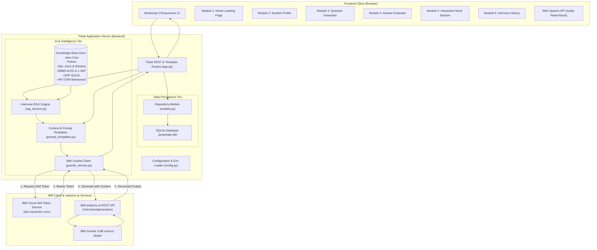

# PrepMate – AI Interview Trainer Agent

[](https://skillsbuild.org/)
[]()
[](https://www.ibm.com/granite)
[]()
[]()
[]()

> **Official Problem Statement:** No. 22 – Interview Trainer Agent  
> **Programme:** AICTE–IBM SkillsBuild University Engagements 2026  
> **Target Audience:** College students, MCA graduates, B.Tech/BE freshers, and job seekers preparing for campus recruitment and technical interviews.

---

## 1. Executive Summary

**PrepMate** is a full-stack, responsive web application and AI interview trainer agent developed to bridge the gap between academic degree curricula and software industry recruitment expectations. 

Powered by **IBM Granite** foundation models through the official **IBM watsonx.ai REST API** and augmented by a domain-specific **Retrieval-Augmented Generation (RAG)** pipeline, PrepMate personalizes questions according to each candidate's unique academic degree, technical skills, projects, and target role.

### Key Highlights
- **Real IBM Granite Foundation Model Integration:** Communicates with `ibm/granite-3-8b-instruct` via IBM Cloud IAM authentication and IBM watsonx.ai text generation services.
- **Local RAG Grounding:** Curated interview knowledge base (Java, Python, SQL, DBMS, OOP, HR STAR technique, fresher guidance) indexed with TF-IDF and cosine similarity to ensure factually accurate, hallucination-resistant evaluation.
- **4-Dimensional Answer Evaluation:** Diagnoses candidate answers across **Relevance**, **Technical Correctness**, **Clarity & Structure**, and **Completeness**, pinpointing omitted concepts and providing model answers.
- **Interactive Mock Interview:** Step-by-step 5-question interview simulator with progress tracking, optional speech synthesis read-aloud, and holistic end-of-session performance appraisal.
- **SQLite Persistence:** Stores candidate profiles, complete interview transcripts, and individual question evaluations with zero external database dependencies.
- **Responsible AI by Design:** Adheres to ethical AI standards—qualitative diagnostic feedback instead of arbitrary score bias, educational disclaimers, and secure server-side credential isolation.

---

## 2. System Architecture



---

## 3. Technology Stack

| Layer | Technologies Used | Description |
|---|---|---|
| **Frontend** | HTML5, CSS3, JavaScript (ES6+), Bootstrap 5.3, Bootstrap Icons | Responsive, clean white & light-blue professional corporate theme with loading overlays and accessibility. |
| **Backend** | Python 3.12+, Flask 3.1 | REST API endpoints, Jinja2 template rendering, session management, and validation. |
| **Foundation Model** | IBM Granite (`ibm/granite-3-8b-instruct`) via IBM watsonx.ai | Official IBM Granite generation for personalized questions, multi-criteria answer evaluation, and session appraisals. |
| **Knowledge Retrieval** | Python, Scikit-learn (TF-IDF Vectorizer), Cosine Similarity | In-memory indexing of 26 curated domain chunks across core computer science and HR topics. |
| **Database** | SQLite3 | Relational schema with foreign keys for candidate profiles, interview sessions, and individual Q&A evaluations. |
| **Authentication & Security** | IBM Cloud IAM OAuth 2.0 | Bearer token caching and server-side secret isolation via `python-dotenv`. |
| **Testing** | Pytest 8.3 | 10 comprehensive automated unit, API, integration, and responsiveness tests. |

---

## 4. Application Modules

### Module 1: Home Page
- **Hero Section:** "Your Personal AI Interview Coach" headline, quick start action buttons, and active candidate preview.
- **Feature Showcase:** Explains IBM Granite integration, RAG grounding, profile awareness, 4-dimension evaluation, interactive mock sessions, and responsible AI.
- **Workflow Guide:** Visual 4-step explanation of candidate profile configuration, knowledge extraction, Granite generation, and diagnostic feedback.
- **Recent Sessions Preview:** Direct review of past interview attempts stored in SQLite.

### Module 2: Student Candidate Profile
- Collects candidate data: Full name, educational qualification, college/university name, technical skills, programming languages, internship experience, capstone projects, certifications, target job role, and experience level.
- Client-side and server-side validation on all mandatory fields.
- Stored in SQLite (`student_profiles` table) with automatic timestamps.

### Module 3: AI Interview Question Generator
- Allows candidates to select: Target job role, interview type (Technical or HR/Behavioral), difficulty (Beginner, Intermediate, Advanced), and question count (3, 5, or 7).
- Combines candidate profile + RAG knowledge base context into Granite prompts.
- Displays questions in clean cards with category badges, interviewer objectives, read-aloud option, and a direct shortcut to evaluate answers.

### Module 4: AI Answer Evaluator
- Candidate submits their answer to any technical or HR interview question.
- IBM Granite evaluates across 4 dimensions:
  1. **Relevance:** Directness of response to the prompt.
  2. **Technical Correctness:** Conceptual and programmatic accuracy.
  3. **Clarity & Structure:** Articulation and communicative flow.
  4. **Completeness:** Coverage of core mechanisms, edge cases, and trade-offs.
- Provides: Missing technical points, improved model sample answer, and concrete action items for improvement.
- Includes Responsible AI disclaimer.

### Module 5: Interactive Text-Based Mock Interview
- Interactive 5-question sequential interview.
- Displays one question at a time with a dynamic progress bar (`Question X of 5`).
- Features a "Listen" button utilizing browser speech synthesis (Web Speech API).
- Candidate enters an answer and receives instant question-level feedback before moving forward.
- Upon completion, IBM Granite synthesizes a comprehensive performance summary, key strengths, priority improvement areas, and placement guidance.

### Module 6: Interview History & Transcript Review
- Persists all mock interview sessions in SQLite.
- Displays interview date, target job role, interview type, questions completed, and feedback summary.
- Includes complete transcript review (`/history/<session_id>`) showing all question-by-question evaluations, model answers, candidate submissions, and attached RAG sources.
- Supports PDF printing and deletion of records.

---

## 5. IBM Granite & watsonx.ai Integration Details

### Architecture & Security
PrepMate communicates with IBM watsonx.ai using secure server-side HTTPS requests:
1. **Never Expose Secrets:** API keys and project IDs remain strictly on the backend inside environment variables (`.env`).
2. **IAM Token Caching:**prepMate exchanges the `WATSONX_APIKEY` with `https://iam.cloud.ibm.com/identity/token` for an OAuth access token, caching it in memory until expiration.
3. **Inference Endpoint:** Calls `{WATSONX_URL}/ml/v1/text/generation?version=2023-05-29` with model parameter `ibm/granite-3-8b-instruct` and decoding parameters (`greedy` / `sample`, `repetition_penalty=1.15`).
4. **Development-Only Mock Mode:** If credentials are not yet configured or if offline development is active, PrepMate provides a transparently labelled mock mode (`is_mock: True`, badge: `IBM Granite (Dev Mock)`) to ensure zero crashes and seamless local testing before configuring IBM Cloud keys.

---

## 6. Retrieval-Augmented Generation (RAG) Architecture

PrepMate implements an in-memory RAG pipeline to ensure that interview questions and evaluations are grounded in domain truth:

```
[knowledge_base/*.txt]
       │
       ▼ (Parsing & Section Extraction)
[26 Knowledge Chunks (Topic + Evaluation Criteria)]
       │
       ▼ (TF-IDF Vectorizer with N-Grams (1,2))
[Sparse TF-IDF Matrix]
       │
       ▼ (Cosine Similarity against Query Context)
[Top-3 Ranked Reference Chunks + Similarity Scores]
       │
       ▼
[Injected into IBM Granite Prompt as Ground Truth]
```

Knowledge Base Files Included:
- `java_questions.txt`: OOP pillars, JVM vs JRE vs JDK, Garbage collection, Collections framework, Multi-threading, Java 8 lambdas & streams.
- `python_questions.txt`: Dynamic memory & GIL, mutable vs immutable, generators & decorators, OOP & dunder methods.
- `sql_questions.txt`: INNER / LEFT / RIGHT / FULL OUTER joins, aggregation, Window functions (ROW_NUMBER, RANK, DENSE_RANK), B-Tree indexing trade-offs, CTEs.
- `dbms_questions.txt`: ACID properties, Normalization (1NF, 2NF, 3NF, BCNF), RDBMS vs NoSQL comparison.
- `oop_questions.txt`: SOLID principles, Composition vs Inheritance, Singleton & Factory design patterns.
- `hr_questions.txt`: Elevator pitch, STAR behavioral method, conflict resolution, career goals.
- `fresher_guidance.txt`: Communication best practices, think-aloud technique, resume & project defense strategy.

---

## 7. Installation & Local Setup

### Prerequisites
- Python 3.10, 3.11, or 3.12
- Git
- Modern Web Browser (Chrome, Firefox, Edge, Safari)

### Step 1: Clone or Navigate to the Repository
```bash
cd c:\PrepMate
```

### Step 2: Create and Activate a Virtual Environment
```bash
# Windows (PowerShell)
python -m venv venv
.\venv\Scripts\Activate.ps1

# Linux / macOS
python3 -m venv venv
source venv/bin/activate
```

### Step 3: Install Dependencies
```bash
pip install -r requirements.txt
```

### Step 4: Configure Environment Variables
Copy `.env.example` to `.env`:
```bash
# Windows (PowerShell)
Copy-Item .env.example .env

# Linux / macOS
cp .env.example .env
```

Open `.env` and fill in your IBM Cloud watsonx.ai credentials:
```ini
# Flask Settings
FLASK_APP=app.py
FLASK_DEBUG=1
SECRET_KEY=prepmate_secure_key_2026
PORT=5000

# IBM Cloud watsonx.ai Credentials
WATSONX_APIKEY=your_ibm_cloud_api_key_here
WATSONX_PROJECT_ID=your_watsonx_project_id_here
WATSONX_URL=https://us-south.ml.cloud.ibm.com
WATSONX_MODEL_ID=ibm/granite-3-8b-instruct
WATSONX_API_VERSION=2023-05-29

# Set to false to enforce live IBM Granite calls
MOCK_MODE=false
```

> **Note:** If you run PrepMate without entering an API key, it will automatically run in clearly labelled **Development Mock Mode** so you can test the full UI and database persistence immediately.

### Step 5: Run the Application
```bash
python app.py
```
Open your browser and navigate to:
```
http://localhost:5000
```

---

## 8. Running Automated Tests

Run the full pytest suite to verify all 10 tests across the application:
```bash
pytest tests/test_app.py -v
```

Expected output:
```
tests/test_app.py::test_home_page_load PASSED                            [ 10%]
tests/test_app.py::test_api_status PASSED                                [ 20%]
tests/test_app.py::test_student_profile_submission_and_validation PASSED [ 30%]
tests/test_app.py::test_rag_knowledge_retrieval PASSED                   [ 40%]
tests/test_app.py::test_granite_service_generation_and_json_parsing PASSED [ 50%]
tests/test_app.py::test_question_generation_api PASSED                   [ 60%]
tests/test_app.py::test_answer_evaluation_api PASSED                     [ 70%]
tests/test_app.py::test_mock_interview_workflow_end_to_end PASSED        [ 80%]
tests/test_app.py::test_history_page_and_detail PASSED                   [ 90%]
tests/test_app.py::test_responsive_meta_tags PASSED                      [100%]

============================= 10 passed in 6.23s ==============================
```

---

## 9. IBM Cloud Deployment Guidance

PrepMate is architected for containerized or serverless deployment on **IBM Cloud**:

### Deployment Option: IBM Cloud Code Engine (Recommended for Lite & Pay-As-You-Go)
IBM Cloud Code Engine runs serverless web apps directly from container images or source code repositories:
1. Log in to IBM Cloud CLI:
   ```bash
   ibmcloud login -u <your-email> -r us-south
   ibmcloud target -g Default
   ```
2. Create a Code Engine project:
   ```bash
   ibmcloud ce project create --name prepmate-project
   ibmcloud ce project select --name prepmate-project
   ```
3. Deploy the application:
   ```bash
   ibmcloud ce app create --name prepmate \
     --build-source . \
     --env WATSONX_APIKEY="<your-api-key>" \
     --env WATSONX_PROJECT_ID="<your-project-id>" \
     --env WATSONX_URL="https://us-south.ml.cloud.ibm.com" \
     --env WATSONX_MODEL_ID="ibm/granite-3-8b-instruct" \
     --env MOCK_MODE="false" \
     --port 5000 \
     --min-scale 1 --max-scale 2
   ```
4. Code Engine will provide a secure public HTTPS URL (e.g., `https://prepmate.xxxx.codeengine.appdomain.cloud`).

---

## 10. Final Academic PPT Screenshots Checklist

For the final project presentation under AICTE–IBM SkillsBuild University Engagements 2026:

- [ ] **Slide 1 - Landing Page (Hero):** Showing PrepMate branding, AICTE–IBM SkillsBuild badge, and "Your Personal AI Interview Coach" hero section.
- [ ] **Slide 2 - Candidate Profile Setup:** Form filled with candidate education, college, programming languages, and capstone project details.
- [ ] **Slide 3 - IBM Granite Model Status:** Showing the navbar pill indicating live IBM Granite connection (`ibm/granite-3-8b-instruct`).
- [ ] **Slide 4 - AI Question Generator:** Displaying generated questions customized to candidate profile, with category badges and interviewer objectives.
- [ ] **Slide 5 - AI Answer Evaluator (4 Dimensions):** Showing the 4-dimension metric cards (Relevance, Technical Correctness, Clarity, Completeness) and omitted concepts.
- [ ] **Slide 6 - Improved Model Answer:** Showing the AI-recommended benchmark answer and actionable improvement suggestions.
- [ ] **Slide 7 - Interactive Mock Interview:** Displaying an active question, progress bar (`Question 2 of 5`), and the Web Speech audio button.
- [ ] **Slide 8 - Mock Interview Final Appraisal:** Showing session summary, key strengths, priority growth areas, and career placement advice.
- [ ] **Slide 9 - SQLite Interview History & Transcript:** Showing the past interview sessions table and full session review page (`/history/<id>`).
- [ ] **Slide 10 - Pytest Automated Test Results:** Showing all 10 automated test cases passing in the terminal.

---

## 11. Academic Attribution & License

- **Programme:** AICTE–IBM SkillsBuild University Engagements 2026
- **Problem Statement:** No. 22 – Interview Trainer Agent
- **Foundation Model:** IBM Granite via IBM watsonx.ai
- **License:** Apache License 2.0

